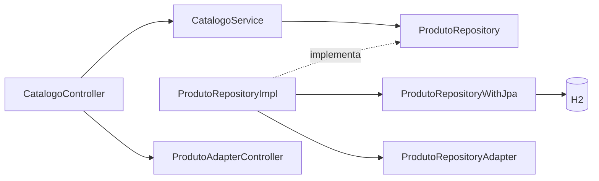

# Modularização e responsabilidades do Poiesis

Cada microsserviço de negócio possui os módulos Maven `domain` e `spring`. O primeiro contém as entidades, os contratos e os serviços de negócio em Java puro. O segundo implementa a API HTTP, a persistência, as integrações e as configurações Spring. O gateway continua sendo uma aplicação independente, responsável pelo roteamento e pela segurança HTTP centralizada.

Há cinco microsserviços de negócio — Produto, Pedido, Produção, Relatório e Login — e o Gateway. Produto substitui as aplicações Catálogo e Customização e atende `/v1/produtos/**` e `/v1/customizacoes/**` na porta 8082. Pedido continua separado, consultando ambas as APIs pela configuração `application.config.produto-url`. As APIs públicas e permissões são preservadas.

## Estrutura

Os módulos usam a mesma raiz de pacotes Java (`com.poiesis.<servico>`). O módulo Maven `spring` identifica a infraestrutura, sem repetir `.spring` no pacote. Por exemplo, `produto/spring/src/main/java/com/poiesis/produto/controller`. Os nomes completos das classes devem ser únicos entre os módulos. O domínio não depende das classes de infraestrutura, mesmo quando compartilham o nome de um pacote.

Estrutura do serviço Produto (trecho de catálogo):

```text
produto/
├── pom.xml
├── domain/
│   ├── pom.xml
│   └── src/main/java/com/poiesis/produto/
│       ├── entity/
│       │   ├── Produto.java
│       │   └── Categoria.java
│       ├── repository/
│       │   └── ProdutoRepository.java
│       └── service/
│           └── CatalogoService.java
└── spring/
    ├── pom.xml
    └── src/main/java/com/poiesis/produto/
        ├── ProdutoApplication.java
        ├── config/
        │   └── BeanConfig.java
        ├── controller/
        │   ├── CatalogoController.java
        │   ├── adapter/
        │   │   └── ProdutoAdapterController.java
        │   └── dto/
        │       ├── request/ProdutoRequest.java
        │       └── response/ProdutoResponse.java
        └── repository/
            ├── ProdutoRepositoryImpl.java
            ├── adapter/
            │   └── ProdutoRepositoryAdapter.java
            ├── orm/
            │   └── ProdutoOrmJpa.java
            └── jpa/
                └── ProdutoRepositoryWithJpa.java
```

Os demais serviços seguem a mesma organização, com as pastas adicionais necessárias ao seu contexto:

| Local | Conteúdo |
| --- | --- |
| `domain/entity` | Entidades, estados e valores de negócio |
| `domain/repository` | Interfaces de persistência, como `PedidoRepository` e `SessaoRepository` |
| `domain/service` | Regras e operações de negócio, como `PedidoService`, `ConsultaPedidoService` e `SessaoService` |
| `domain/integration` | Interfaces para consultar serviços externos, como `CatalogoIntegration` |
| `domain/security` | Contratos de autenticação, criptografia e emissão de token do login |
| `domain/messaging` | Contrato de publicação de eventos do pedido |
| `domain/exception` | Exceções de negócio |
| `spring/controller` | Controllers e tradução de erros HTTP |
| `spring/controller/dto` | Formatos de entrada e saída da API |
| `spring/controller/adapter` | Conversão entre DTOs HTTP e entidades de negócio |
| `spring/repository` | Implementações dos repositories do domínio |
| `spring/repository/adapter` | Conversão entre entidades de negócio e representações ORM |
| `spring/repository/orm` | Classes com anotações JPA e detalhes das tabelas |
| `spring/repository/jpa` | Interfaces técnicas que estendem `JpaRepository` |
| `spring/integration` | Implementações HTTP e clientes RestClient |
| `spring/security` | Implementações BCrypt, autenticação Spring, emissão JWT e UserDetails do login |
| `spring/messaging` | Publicadores e consumidores RabbitMQ, com seus contratos JSON locais |
| `spring/config` | Composição dos serviços e configuração técnica |

Os caminhos da tabela são relativos à raiz de pacotes de cada módulo. Por exemplo, `entity` fica em `produto/domain/src/main/java/com/poiesis/produto/entity`, enquanto `controller` fica em `produto/spring/src/main/java/com/poiesis/produto/controller`. Cada serviço contém apenas as pastas de que precisa.

As coordenadas Maven continuam específicas, como `produto-domain` e `produto-spring`. Isso permite construir os cinco serviços de negócio sem colisões entre artefatos com o mesmo nome. Java, Spring Boot, H2 e as demais dependências continuam próprios do Poiesis.

## O papel de cada classe

O fluxo de uma operação de produto é:



- `Produto` representa o produto para as regras de negócio.
- `ProdutoRepository` declara o que o domínio precisa persistir e consultar.
- `ProdutoRepositoryImpl` implementa esse contrato usando o Spring Data.
- `ProdutoRepositoryWithJpa` fornece as operações técnicas de banco.
- `ProdutoOrmJpa` representa a estrutura persistida, incluindo anotações JPA e controle de versão.
- `ProdutoRepositoryAdapter` converte `Produto` e `ProdutoOrmJpa`.
- `ProdutoAdapterController` converte entidades de negócio e DTOs HTTP.
- `BeanConfig` instancia os serviços puros e injeta suas dependências.

O sufixo `Jpa` identifica a tecnologia de persistência; H2 é o banco configurado em `application.properties`. As classes de domínio permanecem independentes dessas duas escolhas.

A entidade de negócio e sua representação ORM possuem funções distintas. A primeira contém o comportamento do negócio; a segunda contém o mapeamento de armazenamento. A conversão pertence ao adapter do repository. Regras de negócio não são copiadas para as classes ORM.

## Separação de responsabilidades

Controllers recebem requisições, convertem DTOs, chamam serviços e montam respostas. Eles não consultam Spring Data nem coordenam chamadas a clientes HTTP. Os serviços dependem das interfaces declaradas no domínio; as implementações técnicas ficam no módulo `spring`.

As responsabilidades principais são:

- **Produto:** reúne catálogo e customizações em uma aplicação e um banco H2. `CatalogoService` administra produtos, preços, categorias e inativação. `CustomizacaoService` consulta diretamente `CatalogoService` para verificar a existência do produto; `OpcaoCustomizacaoService` mantém as validações e operações das opções. Não há chamada HTTP nem Feign entre essas funcionalidades.
- **Pedidos:** `PedidoService` coordena catálogo, seleção das customizações, persistência e publicação. `SelecionarCustomizacoesService` valida as opções e `ConsultaPedidoService` preserva o acesso aos próprios pedidos.
- **Produção:** `ProducaoService` administra as ordens; `ResumoProducaoService` consulta o resumo por `ResumoProducaoRepository`. As contagens e a transação de leitura consistente ficam em `ResumoProducaoRepositoryImpl`.
- **Relatórios:** `RegistroVendaService` valida e registra vendas sem repetir pedidos. `VendasRepositoryImpl` acessa o banco e `ProducaoIntegrationImpl` consulta produção por HTTP. O consumidor de eventos traduz mensagens para chamadas ao serviço.
- **Login:** `CadastroUsuarioService`, `AutenticacaoService`, `UsuarioService` e `SessaoService` concentram as operações de negócio. As implementações de credenciais, BCrypt, JWT e revogação persistida ficam no módulo Spring.

Os serviços agrupam operações relacionadas sem exigir uma classe por método. As dependências são injetadas por construtor e a composição fica em `BeanConfig`. Os adapters do controller e do repository têm motivos de mudança distintos e permanecem separados.

## Fluxo de customização

O cliente escolhe um produto ativo, seleciona no máximo uma opção ativa de cada tipo cadastrado pelo administrador (por exemplo, cor, tamanho ou técnica), informa opcionalmente um texto e seleciona uma arte da biblioteca Poiesis ou fornece uma URL pública HTTP/HTTPS. O Pedido recebe apenas os identificadores das opções e os dados de arte; o serviço recalcula preço e captura o snapshot das opções no pedido para que mudanças futuras do catálogo não alterem compras anteriores.

A biblioteca visual do frontend fica em `poiesis-frontend/assets/customization`. As artes-base são identificadas no pedido pelo formato `asset://poiesis/<id>` e são validadas pelo microsserviço de Pedido. Imagens próprias usam URL HTTP/HTTPS; o armazenamento de upload de arquivos não faz parte deste fluxo e deve ser integrado posteriormente a um storage de objetos antes de aceitar arquivos privados.

A segurança HTTP continua centralizada no gateway. O login emite tokens e mantém o estado das sessões. Somente autoridades com prefixo `ROLE_` são convertidas em perfis do JWT; autoridades técnicas de fator, como `FACTOR_PASSWORD`, não são perfis de negócio e ficam fora do token. Os demais serviços continuam acessíveis apenas pela rede interna configurada para a execução local.

## Contratos e execução

As rotas HTTP, os campos JSON, os nomes das tabelas e as regras de negócio do Poiesis são preservados. As consultas JPQL acompanham os novos nomes das classes ORM. Consumidores RabbitMQ usam seu próprio `messaging.event.PedidoCriadoEvent` para ler o JSON publicado pelo Pedido. A inferência do tipo pelo método do listener preserva a leitura dos cabeçalhos antigos `com.poiesis.pedido.springframework.messaging.PedidoCriadoEvent`, `com.poiesis.pedido.springframework.adapter.out.messaging.PedidoCriadoEvent` e `com.poiesis.pedido.spring.messaging.PedidoCriadoEvent`, além do atual `com.poiesis.pedido.messaging.PedidoCriadoEvent`.

Pedido publica no exchange `pedido.eventos`, com routing key `pedido.criado`. Produção e Relatório mantêm filas próprias e duráveis; ambos recebem uma cópia do evento. Todos usam `application.rabbitmq.exchange` e `application.rabbitmq.routing-key`; cada consumidor usa `application.rabbitmq.queue`, e o listener acompanha o nome da fila configurada. Mensagens com identificadores inválidos são rejeitadas sem reenfileirar. Entregas repetidas de um pedido já registrado não criam uma nova ordem ou venda.

Produto não precisa de mensageria no fluxo atual. Pedido consulta suas APIs HTTP; Relatório consulta o resumo HTTP de Produção. Pedido traduz respostas 400/404 de produto inexistente para erro 400 do pedido; falhas HTTP do serviço consultado continuam sendo indisponibilidade 503. As implementações ficam em `spring/src/main/java/com/poiesis/<servico>/integration`, e os contratos usados pelas regras de negócio ficam no domínio.

O salvamento do pedido e a publicação AMQP continuam sendo operações separadas. Esta organização não garante atomicidade entre banco e broker; uma falha de publicação depois do salvamento exige tratamento operacional ou uma futura estratégia de outbox.

O script `iniciar-projeto.sh` compila cada serviço a partir de seu POM agregador e usa os jars em `<servico>/spring/target`. Encerre as aplicações antigas de Catálogo e Customização antes de iniciar esta estrutura. Os bancos dessas aplicações eram H2 em memória; Produto usa o banco em memória `produto`, sem migração de dados persistidos.

```bash
python3 poiesis-backend-spring/tests/arquitetura_hexagonal.py
mvn -f poiesis-backend-spring/pedido/pom.xml clean test
```

As verificações estáticas conferem os módulos `domain` e `spring`, a correspondência entre pacotes e diretórios, a independência do domínio, a separação dos adapters e a localização de ORM e repositories JPA. Os testes Maven verificam os comportamentos do sistema, incluindo persistência, atualização, customizações, acesso aos pedidos, sessões e mensagens.


## Validação da revisão de pacotes e comunicação

Em 21/10/2026, os seis aplicativos foram compilados e empacotados com `mvn -o -f <servico>/pom.xml clean package`. Passaram 47 testes Java: Produto (9), Login (7), Pedido (9), Produção (6), Relatório (8) e Gateway (8), além das 9 verificações estáticas de arquitetura.

Foi executado também `tests/fluxo_sem_estoque.py` contra os seis JARs em portas temporárias, bancos H2 em memória e um RabbitMQ Docker isolado. O fluxo confirmou cadastro, login, sessão, permissões, cadastro e edição de produto e customizações, criação e consulta de pedido personalizado, cálculo de adicionais, preservação do histórico, entrega do evento às duas filas, atualização de produção e consulta dos relatórios. Os processos e o broker temporários foram encerrados após o teste; os serviços e dados existentes não foram usados.

A revisão corrigiu a inclusão indevida de `FACTOR_PASSWORD` nos perfis do JWT e o tratamento de produto inexistente como indisponibilidade. Os testes de mensageria verificam o contrato JSON, cabeçalhos históricos, roteamento configurável, entregas repetidas e rejeição de eventos inválidos sem reenfileiramento. Os testes HTTP de Relatório verificam o resumo de Produção e a tradução de respostas vazias, JSON inválido e falhas HTTP para 503.


## Execução no Windows

Use `iniciar-projeto.cmd` para compilar e iniciar as seis aplicações, `iniciar-projeto.cmd parar` para encerrar e `iniciar-projeto.cmd -SemCompilar` para iniciar JARs já preparados. O wrapper chama `iniciar-projeto.ps1` no Windows PowerShell. Requisitos, logs, testes e preparação da apresentação estão em [EXECUTAR-WINDOWS.md](EXECUTAR-WINDOWS.md). O iniciador Linux permanece disponível.
